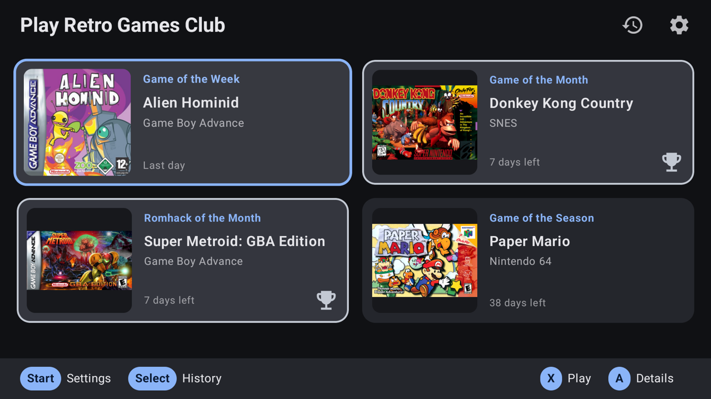
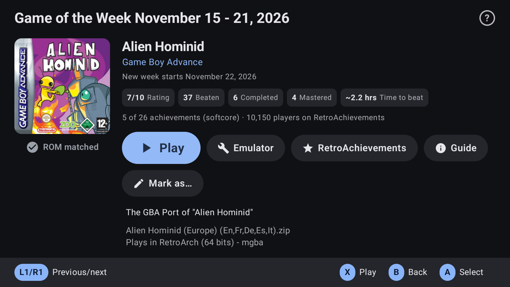
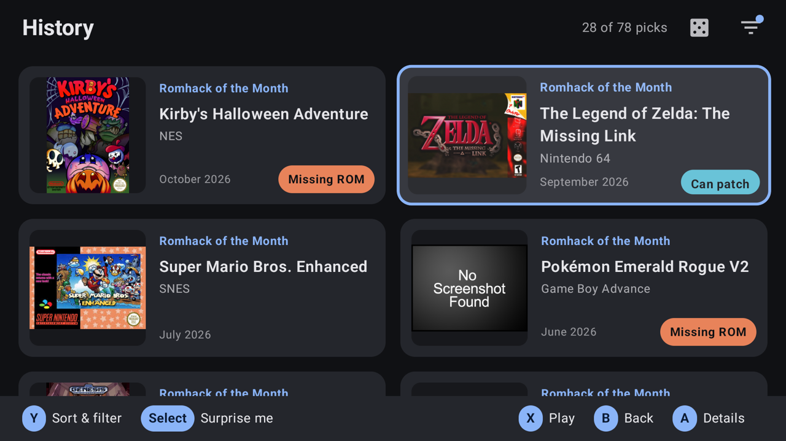
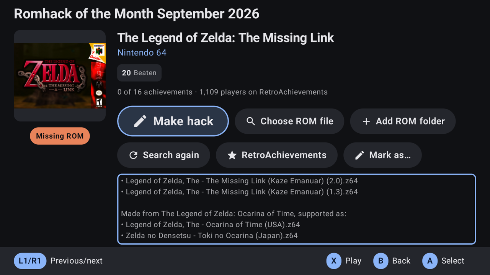
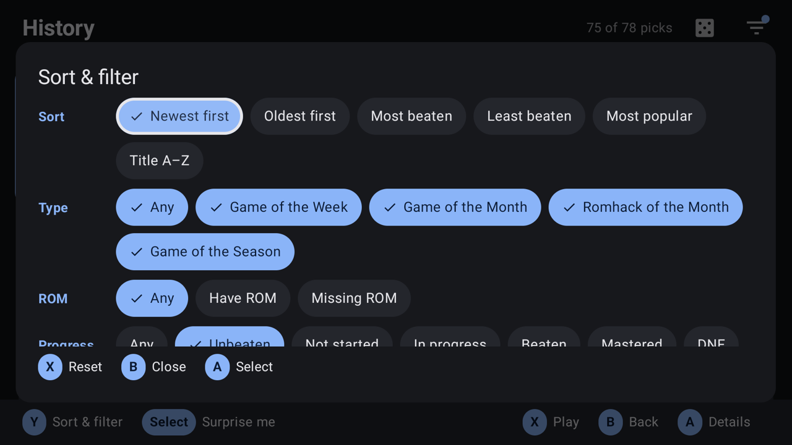

# PRGC Launcher

An Android app that shows what the
[Play Retro Games Club](https://www.joeysretrohandhelds.com/play-retro-games-club/)
is playing right now (Game of the Week, Game of the Month, Romhack of the Month,
Game of the Season and any specials) and launches each game from your own ROMs in
an installed emulator. It's built for controller-first handhelds such as the
Retroid Pocket 5 (Android 13), and is the Android counterpart of the
[NextUI Pak](https://github.com/jakesearle/nextui-play-retro-games-club).

[](https://apps.obtainium.imranr.dev/redirect?r=obtainium://add/https://github.com/jakesearle/android-play-retro-games-club)

Install and update it with [Obtainium](https://github.com/ImranR98/Obtainium), which
follows this repository's GitHub releases, or download the APK from the
[latest release](https://github.com/jakesearle/android-play-retro-games-club/releases/latest).

Not affiliated with Joey’s Retro Handhelds, the Play Retro Games Club or RetroAchievements.

| | |
|---|---|
|  |  |
|  |  |



## How it works

- **The club's picks** come from the club's page, read the same way as the
  NextUI Pak. The page is cached, and the app asks the site again only after 6
  hours or the club's next announced change. Offline, it shows the saved picks.
- **Finding a pick among your ROMs** works by RetroAchievements hash. The app
  checks the ROMs in your folders for that console against RetroAchievements'
  list of known ROMs, so any file name works but only a recognized version
  counts. Cartridge ROMs can be plain, zipped or in a .7z. Discs are matched for
  PlayStation 1 and 2, Sega CD, Saturn, PC Engine CD and Dreamcast (CHD, CUE/BIN,
  ISO, GDI), PSP (ISO, CSO, PBP, CHD) and GameCube (ISO, GCM, RVZ, WIA and GCZ).
  Once a game has launched, its file is remembered.
- **Launching** uses the open emulator catalogue published by
  [CocoonFE](https://github.com/KansoMirai/CocoonFE), downloaded and cached at
  runtime, to build each emulator's launch intent. When several are installed, the
  default is the one [Joey's Retro Handhelds recommends](https://joeysretrohandhelds.com/guides/recommended-android-emulators/)
  (a RetroArch core or a standalone app), unless you've chosen another.
- **Your RetroAchievements progress** shows once you sign in (Settings ›
  RetroAchievements) with your username and Web API key, kept encrypted on the
  device. Counts are hardcore; softcore-only progress is marked. Beaten and
  mastered games get a trophy on their card.
- **Romhacks from your base ROM.** When a romhack pick is missing but you have the
  game it's built on, its card says *Can patch* and its game view offers *Make hack*: the
  app downloads the hack's patch from RetroAchievements'
  [RAPatches](https://github.com/RetroAchievements/RAPatches) (BPS, IPS or xdelta), applies
  it, and keeps the result only if RetroAchievements recognises it as that hack (the newest
  such version, when there are several). Signed in, RetroAchievements' list of supported
  files says which patch to use, and only that patch is downloaded, not the whole archive. It's saved next to the base ROM, or in that
  folder's `Hacks` subfolder if there is one.
- **For a missing game**, its game view lists the file names RetroAchievements supports
  (when you're signed in), so you know which version to look for; for a romhack, the
  patched files and the base game's ROMs it's made from.
- **Your own marks** cover what RetroAchievements can't know: mark a game
  *Completed somewhere else* (counts as beaten) or *Did not finish* from its
  game view. A beaten or mastered award on RetroAchievements takes precedence.

## Reference

- [Emulator reference](docs/EMULATORS.md): consoles and emulators RetroAchievements
  supports, the Android emulators in the Obtainium Emulation Pack, how they overlap,
  and which ES-DE ROM folder names the app recognizes.

- [Third-party notices](THIRD-PARTY-NOTICES.md): code ported from rcheevos and libchdr,
  and the libraries the app uses.

## Roadmap

### Before release (sharing on the club's Discord)

**Features**
- **Game manuals.** Looked into (November 2026): RetroAchievements has no manual link
  (its API's only link is `GuideURL`, a guide). The one source keyed by ROM hash is
  [ScreenScraper](https://www.screenscraper.fr/webapi2.php) (`jeuInfos.php` by CRC/MD5/SHA-1
  plus size, then `mediaManuelJeu.php` for the PDF). It needs a registered developer ID and
  password, has per-user quotas, and its terms allow it only in free apps (data under
  CC BY-NC-SA). Matching manuals by title instead (archive.org, Retro Game Manuals) risks the
  wrong one, so it's on hold until we decide on ScreenScraper.

**Release basics**
- **In-app "new version available" check** against this repository's GitHub releases.
  Releases are signed, shrunk with R8 and published here (the first is 0.1.0); Obtainium
  already picks up new ones.
- **Testing beyond the Retroid Pocket 5:** 4:3 and near-square screens, small 3.5-4" displays,
  Android 10-15, and handhelds with A/B swapped.

**ROM matching**
- **More disc formats.** Not read yet: GameCube WBFS/CISO, Wii (encrypted partitions), and
  3DO, Neo Geo CD, Jaguar CD and PC-FX. GameCube RVZ is checked against a real disc (Super
  Mario Sunshine matches RetroAchievements), and so are PSP ISO and DVD CHD (zstd) images
  (Grand Theft Auto: Chinatown Wars and Lumines match) and PS1 CD CHDs (six games, all
  three CD codecs). Sega CD, Saturn, PC Engine CD,
  Dreamcast, GameCube ISO/GCZ, and CHDs using `huff` or `flac`, are tested on made-up
  images; they still need checking on a real disc of each.

## Later

Ideas we've looked into and set aside for now.

- **A feed from the club's site.** The app reads the club's web page (Joey's Retro
  Handhelds know). A small JSON feed, if they ever offer one, wouldn't break when the site
  is redesigned.

- **Start from the auto save state (Resume).** Like the NextUI Pak's X, offer to carry on
  from where you quit. It depends on the emulator:
  - **Joey64** only loads a state when its own library asks: that extra
    (`com.joeysretro.joey64.LOAD_STATE`) is accepted only through its non-exported
    `.GameStart` alias, and its "Continue on Play" setting (Settings › Saves) is applied by its
    library, so games other apps start always begin from power-on. This needs a change in
    Joey64 first, for example applying "Continue on Play" to games other apps start, or a
    public extra for the auto state only. Then the club app can pass it.
  - **DuckStation** takes a `resumeState` boolean extra; the catalogue's entry passes
    `false`, so a Resume button could pass `true`.
  - **RetroArch** has no per-launch option, but its own *Settings › Saving › Auto Load State*
    applies to every launch, including from this app.

## Out of scope

- **Being a Home app (launcher replacement).** This app opens from the app
  drawer like any other app. It won't register as a Home app or try to replace
  the device's launcher, and that isn't planned.
- **Copying RetroAchievements' own screens.** No achievement lists, badges,
  leaderboards or profile pages. The game view already links to each game's
  RetroAchievements page, and RetroArch shows achievements in-game. The app uses
  RetroAchievements only for what helps with the club's picks: a trophy for
  beaten and mastered games, a one-line progress summary, the next achievement
  towards beating the game, and History's progress filter and popularity sort.

## Development

```bash
./gradlew test                    # unit tests
./gradlew :app:installDebug       # install on a connected device
```

Add `-PcatalogueLive=true` to check every entry of the live emulator catalogue,
or `-PclubPage=/path/to/saved.html` to check the parser against a saved copy of
the club's page. `-PromFile=/path/to/image -PromConsole=41 -PromHashes=/path/to/list.json`
hashes a real disc image (console ID from RetroAchievements; the list is a saved
`dorequest.php?r=hashlibrary&c=41`) and says whether RetroAchievements recognises it.

GitHub Actions runs the unit tests and lint on every push and pull request
(`.github/workflows/ci.yml`); the reports are kept as a build artifact.

## Licence

[MIT](LICENSE). Code ported from rcheevos (MIT) and libchdr (BSD-3-Clause) keeps its own
licence; see [THIRD-PARTY-NOTICES.md](THIRD-PARTY-NOTICES.md).
